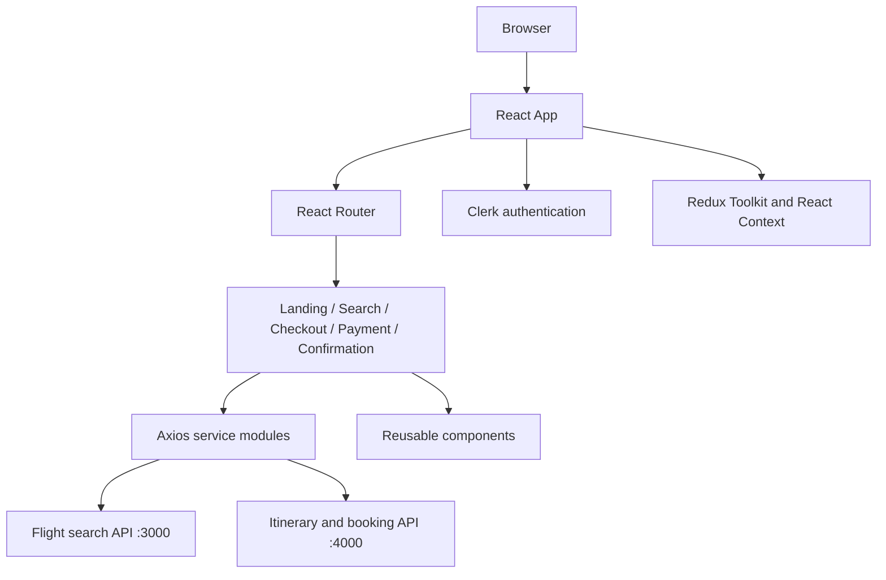

# Flight Booking Web App | Frontend

A React-based flight booking frontend built with Vite. The application provides a multi-step travel booking experience that includes a landing page, flight search, checkout, payment, and booking confirmation screens. It uses React Router for navigation, Clerk for authentication, Redux Toolkit for shared state, Axios for backend communication, and Tailwind CSS for styling.

This repository contains the **client application only**. The frontend expects separate backend services for flight search and itinerary/booking operations. The current service modules use local development URLs on ports 3000 and 4000, so the corresponding backend services must be available for end-to-end booking flows.

## Contents

- [Project overview](#project-overview)
- [Features and user journey](#features-and-user-journey)
- [Technology stack](#technology-stack)
- [Architecture](#architecture)
- [Project structure](#project-structure)
- [Prerequisites](#prerequisites)
- [Installation and local development](#installation-and-local-development)
- [Application routes](#application-routes)
- [Backend integration](#backend-integration)
- [Authentication and payment boundaries](#authentication-and-payment-boundaries)
- [Build and quality commands](#build-and-quality-commands)
- [Deployment notes](#deployment-notes)
- [Known limitations and configuration gaps](#known-limitations-and-configuration-gaps)
- [Troubleshooting](#troubleshooting)
- [Contributing](#contributing)

## Project overview

The frontend guides a user through a typical flight-booking workflow:

1. Open the landing page.
2. Enter journey details and search for available flights.
3. Review flight results and proceed to checkout.
4. Provide passenger and booking information.
5. Continue through the payment screen.
6. View a confirmation screen after the booking flow completes.

The UI is organized into page-level components under `src/pages`, reusable interface components under `src/components`, and backend request functions under `src/services`. Authentication is integrated through Clerk, and application state is shared through Redux Toolkit and React context.

## Features and user journey

| Area | Implementation evidence |
|---|---|
| Landing experience | `LandingPage.jsx` |
| Flight search | `SearchPage.jsx` and `SearchFlightsAPI.js` |
| Checkout | `CheckoutPage.jsx` |
| Payment screen | `PaymentPage.jsx` |
| Confirmation | `ConfirmationPage.jsx` |
| Authentication | Clerk React components and route guards |
| Shared state | Redux Toolkit store and slices |
| API communication | Axios service modules |
| Notifications | React Hot Toast and toast context |
| UI effects and icons | Framer Motion, Lucide React, React Icons |

The presence of a payment page does not mean this frontend independently processes or securely verifies payments. Payment authorization, settlement, and booking confirmation must be handled by the backend and payment provider.

## Technology stack

- **React 19:** component-based UI.
- **Vite 6:** development server and production bundler.
- **React Router 7:** client-side route navigation.
- **Clerk React:** sign-in and session-aware UI.
- **Redux Toolkit and React Redux:** shared application state.
- **Axios:** HTTP requests to backend services.
- **Tailwind CSS:** utility-first styling.
- **Framer Motion:** interface animation.
- **React Hot Toast:** user-facing notifications.
- **Day.js:** date utilities.
- **Crypto-JS:** SHA-256 identifier generation in client service helpers.

## Architecture



### Frontend request flow

- The user interacts with a page component.
- The page reads or updates application state.
- A service module builds the request and calls the relevant backend URL.
- The backend response is returned to the page or shared state.
- The UI displays results, errors, or the next workflow step.

The frontend and backend are separate runtime responsibilities. A successful Vite build does not verify that the backend endpoints exist or that booking transactions complete correctly.

## Project structure

```text
.
├── public/                     # Static public assets
├── src/
│   ├── clerk/                  # Clerk authentication integration
│   ├── components/             # Shared UI and booking components
│   ├── context/                # React context providers
│   ├── pages/
│   │   ├── LandingPage.jsx
│   │   ├── SearchPage.jsx
│   │   ├── CheckoutPage.jsx
│   │   ├── PaymentPage.jsx
│   │   └── ConfirmationPage.jsx
│   ├── redux/
│   │   ├── Slices/             # Redux state slices
│   │   └── store.js
│   ├── services/
│   │   ├── SearchFlightsAPI.js
│   │   ├── ItinenaryAPI.js
│   │   └── bookingAPI.js
│   ├── utils/                  # Shared helpers, including airport information
│   ├── App.jsx                 # Route and authentication composition
│   ├── App.css
│   ├── index.css
│   └── main.jsx                # React application entry point
├── index.html
├── package.json
├── package-lock.json
├── vite.config.js
├── tailwind.config.js
└── README.md
```

## Prerequisites

- Node.js compatible with Vite 6 and React 19.
- npm.
- Git.
- A Clerk application and its frontend publishable key.
- The companion flight-search backend expected at `http://localhost:3000`.
- The companion itinerary and booking backend expected at `http://localhost:4000`.

The two backend services are not contained in this frontend repository. Their routes, database, payment provider setup, and runtime must be configured separately.

## Installation and local development

Clone the repository and install the locked dependencies:

```bash
git clone https://github.com/Brajesh31/Flight_Booking_Web_App_Client.git
cd Flight_Booking_Web_App_Client
npm ci
```

Configure the Clerk publishable key using the variable name expected by the Clerk initialization code in `src/main.jsx` or the Clerk integration module. Vite exposes client-side variables only when they use the `VITE_` prefix. A publishable key is designed for client use; never put a Clerk secret key, payment secret, or backend private credential in a Vite variable.

Start the development server:

```bash
npm run dev
```

Vite prints the local development URL. Open that address in a browser.

## Application routes

The route composition in `src/App.jsx` currently defines:

| Route | Page | Access behavior |
|---|---|---|
| `/` | Landing page | Public |
| `/search` | Search page | Route is registered in the app |
| `/checkout` | Checkout page | Route is registered in the app |
| `/payment` | Payment page | Clerk sign-in required |
| `/confirmation` | Confirmation page | Clerk sign-in required |

The application waits for Clerk to load before rendering its route content. The payment and confirmation routes redirect signed-out users to Clerk sign-in with the intended destination.

## Backend integration

The current service modules contain these development endpoints:

| Service module | HTTP operation | Current endpoint |
|---|---|---|
| `SearchFlightsAPI.js` | GET | `http://localhost:3000/api/v1/flightinstance/` |
| `ItinenaryAPI.js` | POST | `http://localhost:4000/api/v1/itinerary` |
| `ItinenaryAPI.js` | GET | `http://localhost:4000/api/v1/itinerary/:id` |
| `ItinenaryAPI.js` | PATCH | `http://localhost:4000/api/v1/itinerary/:id` |
| `bookingAPI.js` | POST | `http://localhost:4000/api/v1/bookings/` |
| `bookingAPI.js` | GET | `http://localhost:4000/api/v1/bookings/:id` |

### Flight search request

The search service converts the selected origin and destination city names into airport codes through the airport utility, combines them into a route string, and sends the route and travel date as query parameters named `trips` and `tripDate`.

### Itinerary operations

The itinerary helper generates a SHA-256 identifier from the user ID and current timestamp, then sends itinerary details including flight ID, route, date, time, passenger count, and price. Separate helpers retrieve an itinerary and attach passenger details.

### Booking operations

The booking helper generates a SHA-256 identifier from the current timestamp and user ID, then submits the flight instance, user, total cost, seat count, itinerary identifier, and generated booking identifier.

These client-generated identifiers are identifiers, not security controls. The backend must independently authenticate the user, validate prices and inventory, authorize the itinerary, and prevent duplicate bookings.

## Authentication and payment boundaries

Clerk is used for the frontend identity experience. The frontend conditionally renders payment and confirmation routes based on sign-in state. This is a UI access boundary only. The backend must independently validate the user's session or token before accepting itinerary, payment, or booking mutations.

Never trust a price, passenger count, flight ID, booking ID, or user ID merely because it came from the browser. The server must reload authoritative flight inventory and pricing, validate availability, and calculate the final amount. Payment confirmation must be verified server-side with the payment provider.

## Build and quality commands

| Command | Purpose |
|---|---|
| `npm run dev` | Start the Vite development server |
| `npm run build` | Create the production bundle in `dist/` |
| `npm run preview` | Preview the production build locally |
| `npm run lint` | Run ESLint across the project |

Run a production build before deployment:

```bash
npm run lint
npm run build
npm run preview
```

A successful frontend build validates bundling, not backend availability or payment correctness.

## Deployment notes

The repository's earlier deployment notes describe static hosting using Google Cloud Storage with Cloud CDN and an HTTP(S) Load Balancer. The Vite production output is `dist/`. The actual infrastructure configuration is external to this source repository and must be provisioned separately.

For static deployment:

1. Run `npm ci`.
2. Configure the public Clerk key for the intended environment.
3. Run `npm run build`.
4. Upload the contents of `dist/` to the static hosting origin.
5. Configure the CDN and HTTPS load balancer.
6. Configure SPA fallback behavior so client-side routes resolve to `index.html`.
7. Configure the backend API origins and CORS policy.
8. Test direct navigation and refresh on `/search`, `/checkout`, `/payment`, and `/confirmation`.

The current service files use hard-coded localhost URLs. Production deployment will not work correctly until those API origins are configurable and point to deployed backend services. This documentation does not change those source files.

## Known limitations and configuration gaps

- The frontend currently targets local backend URLs on ports 3000 and 4000.
- No frontend environment-based API origin configuration is visible in the inspected service modules.
- The companion backend repositories/services are not included here.
- Payment verification and booking integrity must be enforced by the backend.
- Client-generated SHA-256 IDs do not replace server-side authorization or idempotency.
- A production static host needs SPA fallback configuration for React Router routes.
- The current repository does not itself prove the availability of live flight inventory or payment settlement.

## Troubleshooting

**Flight search fails.** Confirm the flight-search backend is running on port 3000 and exposes the expected `/api/v1/flightinstance/` route. Check browser network errors and CORS configuration.

**Itinerary or booking requests fail.** Confirm the companion service is running on port 4000 and the route paths match the frontend service modules.

**Clerk does not load.** Verify the publishable key, Clerk application domain, allowed origins, and sign-in configuration.

**A deployed route returns 404 on refresh.** Configure the static host or load balancer to serve `index.html` for application routes.

**The frontend builds but booking does not complete.** A frontend build does not test backend endpoints, database persistence, flight inventory, payment provider webhooks, or booking confirmation. Test those services separately.

## Contributing

See [CONTRIBUTING.md](CONTRIBUTING.md), [docs/ARCHITECTURE.md](docs/ARCHITECTURE.md), and [docs/DEVELOPMENT.md](docs/DEVELOPMENT.md) before changing the route flow, API service contracts, authentication, or deployment behavior.


## Documentation library

- [Architecture](docs/ARCHITECTURE.md): route structure, state ownership, services, and system boundaries.
- [Development guide](docs/DEVELOPMENT.md): local setup, testing, debugging, and contribution workflow.
- [Booking workflow](docs/BOOKING_WORKFLOW.md): user journey, transaction stages, failure states, and trust boundaries.
- [API contracts](docs/API_CONTRACTS.md): flight search, itinerary, and booking endpoint expectations.
- [Deployment guide](docs/DEPLOYMENT.md): static hosting, SPA routing, CDN, HTTPS, and release checks.
- [Contributing](CONTRIBUTING.md), [security policy](SECURITY.md), and [community guidelines](CODE_OF_CONDUCT.md).

Last updated: 2026-11-13 18:43 UTC
