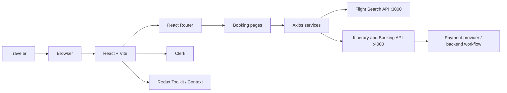
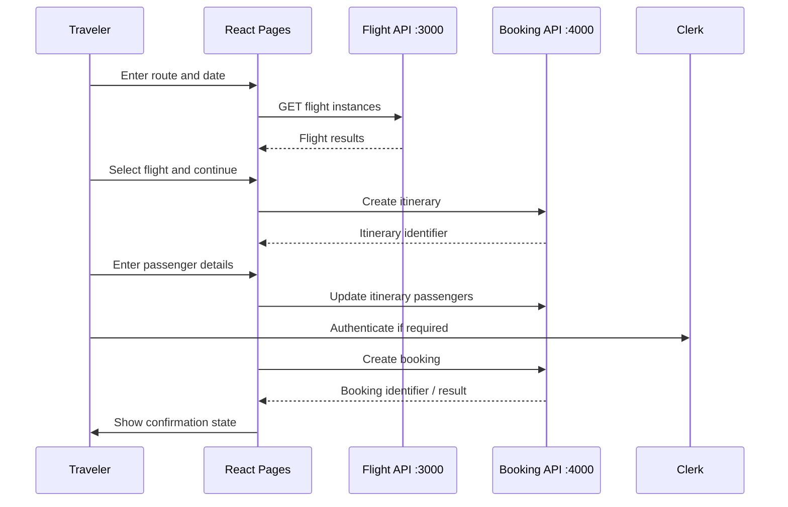

# Flight Booking Frontend Architecture

## 1. Scope

This document describes the frontend architecture visible in this repository. It focuses on route composition, page responsibilities, shared state, authentication, service modules, and the boundary between the browser and the companion backend services.

The repository is a client application. It does not contain the complete flight inventory, itinerary persistence, booking database, or payment-processing infrastructure.

## 2. System context

The payment provider and backend internals are outside this repository. The diagram shows the frontend integration boundary, not a claim that all downstream components are implemented here.

## 3. Application entry and composition

The application entry point is `src/main.jsx`. It mounts the React application and composes the global providers required by the UI. The root component in `src/App.jsx` coordinates Clerk loading, signed-in state, and route definitions.

The route tree currently includes:

- `/`: landing page.
- `/search`: flight search.
- `/checkout`: checkout.
- `/payment`: signed-in payment flow.
- `/confirmation`: signed-in confirmation flow.

Clerk loading is handled before route content is displayed. Payment and confirmation use signed-in and signed-out branches, with signed-out users redirected to sign-in while preserving the intended destination.

## 4. Page responsibilities

| Page | Responsibility in the user journey |
|---|---|
| `LandingPage.jsx` | Entry experience and initial journey discovery |
| `SearchPage.jsx` | Collect route/date criteria and display flight search results |
| `CheckoutPage.jsx` | Review the selected flight and collect booking information |
| `PaymentPage.jsx` | Present the payment stage for authenticated users |
| `ConfirmationPage.jsx` | Present the final booking state to the user |

Keep route-level orchestration in page components. Shared visual elements should live under components, and reusable network calls should remain in service modules.

## 5. State management

The repository includes Redux Toolkit, a central store, and slice modules under `src/redux/Slices`. React context is also used for cross-cutting concerns such as toast notifications.

A useful ownership rule is:

- Use local component state for temporary input and presentation state.
- Use Redux for state that must be shared across distant parts of the booking journey.
- Use context for cross-cutting provider behavior where it is already established.
- Treat backend responses as authoritative for flight availability, pricing, itinerary state, and booking status.

Do not treat browser state as authoritative transaction data. State can be modified by users and may become stale between search and checkout.

## 6. Service layer

The `src/services` directory contains Axios-based service helpers.

### SearchFlightsAPI

The search helper accepts origin city, destination city, and date. It converts the city names into airport codes through the airport utility, constructs a route string, and sends a GET request to:

`http://localhost:3000/api/v1/flightinstance/`

The query parameters are `trips` and `tripDate`.

### ItinenaryAPI

The itinerary service exposes create, retrieve, and passenger-update operations against the backend on port 4000.

- Create: POST `/api/v1/itinerary`
- Retrieve: GET `/api/v1/itinerary/:id`
- Fill passenger details: PATCH `/api/v1/itinerary/:id`

The create helper derives an identifier from the user ID and current timestamp using SHA-256, then sends itinerary and journey information.

### bookingAPI

The booking service exposes:

- Create: POST `/api/v1/bookings/`
- Retrieve: GET `/api/v1/bookings/:id`

The create helper sends flight instance, user, total cost, seat count, itinerary ID, and a generated booking ID.

The service functions are client helpers. They do not independently authenticate requests, verify inventory, calculate trusted prices, or guarantee idempotency.

## 7. Booking workflow

This sequence is an architectural overview of the frontend's calls and screens. The exact order and server-side transaction behavior must be confirmed against the companion backend implementation.

## 8. Identity and trust boundaries

Clerk provides the frontend sign-in state. The UI uses that state to control access to selected routes. This is not a replacement for backend authorization.

The backend must:

- Verify the user's identity on every protected request.
- Confirm that the itinerary belongs to the authenticated user.
- Confirm that the selected flight instance is valid and still available.
- Recalculate the price using server-side data.
- Validate passenger counts and passenger details.
- Prevent duplicate booking and payment side effects.
- Return a final booking state only after authoritative processing.

Client-generated IDs are useful references but are not proof of identity or ownership.

## 9. Deployment architecture

The frontend uses Vite and produces a static `dist/` directory. The README's deployment notes describe a Google Cloud static hosting arrangement with Cloud Storage, Cloud CDN, and an HTTPS load balancer. The infrastructure configuration is not defined by the frontend source itself.

When deploying as a single-page application, the hosting layer must return `index.html` for client-side routes. API requests must target deployed backend URLs, and the backend must allow the production frontend origin.

## 10. Current architecture constraints

- API URLs are hard-coded to localhost in the service modules inspected.
- Flight search and booking use separate local backend ports.
- Backend source is not part of this repository.
- Client route guards do not secure backend endpoints.
- Client-side price and ID values must be revalidated by the server.
- The frontend build does not verify payment settlement or booking persistence.

## 11. Safe extension guidelines

When adding a page, define its route and access policy in `App.jsx`. When adding a shared state domain, decide whether it belongs in a Redux slice or an existing context. When adding backend communication, create or extend a service module and document the request and response contract.

Before changing the booking flow, identify which service owns each state transition. Do not create a second client-side source of truth for a value already managed by the backend.

## 12. Architecture review checklist

- [ ] Route is registered and access policy is explicit.
- [ ] Page responsibility is clearly defined.
- [ ] Shared state has a single intended owner.
- [ ] Network calls are isolated in service modules.
- [ ] Loading, empty, and error states are handled.
- [ ] Backend validates all security-sensitive inputs.
- [ ] Prices and inventory are authoritative on the server.
- [ ] Booking and payment operations are idempotent.
- [ ] Direct route navigation works in deployment.
- [ ] README and development documentation reflect the change.
