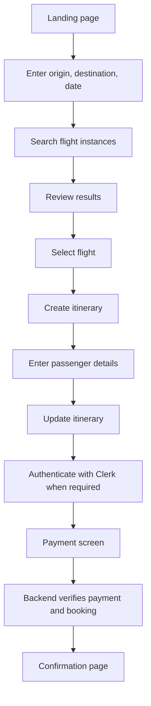

# Flight Booking User Journey and Workflow

## Purpose

This document describes the user-facing booking journey represented by the frontend pages and service helpers. It separates frontend navigation from authoritative backend transaction processing.

## Journey overview

The final payment and confirmation steps depend on backend and provider behavior. The frontend must not mark a booking confirmed solely from local state.

## Search stage

The search page collects journey criteria. The search service maps city names to airport codes and sends a request to the flight service. The backend is responsible for returning valid flight instances and current availability. Search results can become stale before checkout.

## Selection and itinerary stage

After a user selects a flight, the itinerary service sends flight, route, date, time, passenger count, and price information to the itinerary backend. The backend must validate the flight identifier, ownership, travel date, passenger count, and price. It must not trust browser-supplied values as authoritative.

## Passenger stage

Passenger details are attached to the itinerary through the itinerary update endpoint. The UI should validate required fields for usability, while the backend must repeat validation and protect personal data. Avoid logging passenger details.

## Authentication stage

Clerk provides sign-in and session state in the frontend. The payment and confirmation routes are guarded in the UI. The backend must still authenticate every protected request independently.

## Payment stage

The payment page is a presentation step. Secure payment processing belongs on the server and payment provider. The server must calculate the final amount, create or confirm the payment intent, verify provider callbacks, and prevent duplicate charges.

## Confirmation stage

The confirmation page should display a booking state retrieved from an authoritative backend response. It should distinguish pending, confirmed, and failed states if the backend exposes them. A browser redirect or local Redux value is not proof of confirmed payment.

## Failure and recovery states

| Stage | Example failure | Expected handling |
|---|---|---|
| Search | Backend unavailable | Explain failure and allow retry |
| Selection | Flight unavailable | Return to search results |
| Itinerary | Validation or persistence failure | Preserve safe form state and show actionable error |
| Passenger details | Invalid data | Highlight fields and avoid duplicate submission |
| Authentication | Session expired | Redirect to sign-in and preserve intended destination |
| Payment | Declined or timed out | Show state based on server verification |
| Confirmation | Booking state unavailable | Do not show false success; allow safe status refresh |

## Duplicate submission protection

Disable repeated submissions in the UI for usability, but implement idempotency on the backend. A browser can retry requests, lose responses, or submit from multiple tabs.

## Accessibility and usability

- Keep each stage's purpose visible.
- Show progress through the multi-step journey.
- Preserve user-entered data when safe.
- Provide clear validation messages.
- Ensure controls are keyboard accessible.
- Announce loading and result changes.
- Do not rely on color alone for booking status.
